# KeenPG Console

The **KeenPG console** is a web page for running PostgreSQL on Kubernetes and OpenShift. From your browser you can create databases, connect applications, take backups and restore them, run SQL on the primary or on a replica, and watch every database on Grafana dashboards. You never need to write YAML.

This page explains every part of the console in simple words, with screenshots.

---
## Contents

<div class="grid cards" markdown>

- 🧭 [How the console works](#how-the-console-works)
- 📖 [Words you will see](#words-you-will-see)
- 📦 [Install with Helm](#install-with-helm)
- 🔑 [Sign in](#sign-in)
- 🔒 [HTTPS and the certificate](#https-and-the-certificate)
- 🖥️ [The screen layout](#the-screen-layout)
- 🏠 [Home](#home)
- ➕ [Create a cluster](#create-a-cluster)
- 📋 [Clusters list](#clusters-list)
- 🗄️ [Inside a cluster](#inside-a-cluster)
- 📈 [Monitoring and logging](#monitoring-and-logging)
- 🔌 [Connect your application](#connect-your-application)
- 💾 [Backup and restore](#backup-and-restore)
- 📝 [SQL Editor](#sql-editor)
- 🛢️ [Databases](#databases)
- 👁️ [Observability](#observability)
- 🔍 [Discovery](#discovery)
- 🚚 [Migration](#migration)
- 👥 [Users and access](#users-and-access)
- 📄 [Other pages](#other-pages)
- ⬆️ [Upgrade the console](#upgrade-the-console)
- ✅ [Common tasks](#common-tasks)
- 🔧 [Troubleshooting](#troubleshooting)
- ⚠️ [Be careful](#be-careful)

</div>

## How the console works

1. **You** fill a form or press a button in the console.
2. **The console** checks that you are allowed to do this. It then saves your request in Kubernetes as a `KeenPGCluster` object and writes an entry in the audit log.
3. **The KeenPG operator**, a program running inside your Kubernetes, sees the request. It creates everything the database needs: pods, disks, network services, passwords, certificates and backup jobs.
4. **The operator keeps watching.** If a pod crashes, a disk is lost or someone deletes a service by mistake, the operator puts it back.

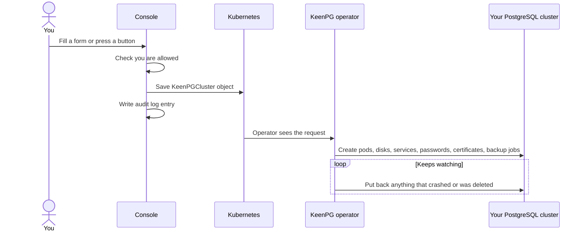

Why this matters:

> [!TIP]
> **The console and the command line always agree.** For clusters, backups and settings, the console only writes the same objects you could write with `kubectl`. Only the **SQL Editor** and **Databases** pages talk to PostgreSQL directly, like any SQL tool.

> [!NOTE]
> **Your databases don't depend on the console.** If the console stops, your databases keep running.

> [!NOTE]
> **Your databases don't depend on the operator either.** If the operator stops, they keep running and failover still works. Only new changes wait until it is back.

---

## Words you will see

| Word | Meaning |
| :---- | :---- |
| 🗂️ **Project** | A group of databases. In Kubernetes this is a *namespace*, for example `apps` or `analytics`. **All projects** shows every project at once. |
| 🐘 **Cluster** | One PostgreSQL database service: one primary and its replicas. |
| 👑 **Primary** (also *leader*) | The main server. All writes go here. |
| 📄 **Replica** (also *standby*) | A live copy of the primary. It can serve reads and takes over if the primary fails. |
| 🤝 **Sync standby** | A replica that confirms every write before the primary says "done", so no data is lost if the primary fails. |
| 🚨 **Failover** | A replica becomes the primary **automatically** because the primary stopped. |
| 🔁 **Switchover** | You move the primary role to a replica **on purpose**, for example before maintenance. |
| ⏱️ **Lag** | How far a replica is behind the primary. `0 B` means fully up to date. |
| 🧭 **Patroni** | The tool inside each pod that chooses the primary and handles failover. |
| 💾 **pgBackRest** | The backup tool. |
| 📦 **Repository (repo)** | Where backups are kept: a disk inside Kubernetes, or object storage (S3, GCS, Azure). |
| ⏪ **Point-in-time restore** | Restoring a database to an exact moment, for example "yesterday at 10:15". |
| 🔀 **PgBouncer** | A connection pooler. Many application connections share a few database connections. |
| 🔐 **Secret** | A safe place in Kubernetes for passwords, keys and certificates. |
| 📡 **Collector** | A small helper container added to each database pod when **Monitoring** is on. It collects metrics and, with **Logging**, the logs. |
| 📊 **Prometheus / Loki / Grafana** | Prometheus stores the metrics, Loki stores the logs, Grafana shows both as dashboards. |

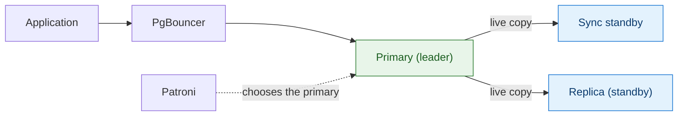

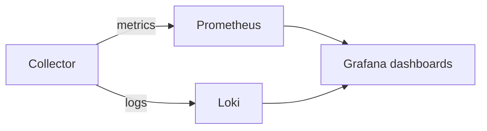

## Install with Helm

> [!NOTE]
> **Skip this part** if KeenPG is already installed for you.

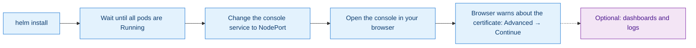

Run this from the folder that holds the chart. It installs everything: the operator, the console and the console's own database.

```sh
helm install keenpg ./keenpg-operator -n keenpg-operator --create-namespace
```

Wait until all pods are **Running**:

```sh
kubectl -n keenpg-operator get pods
```

```text
NAME                                READY   STATUS    RESTARTS   AGE
keenpgo-7b8d8dcc4f-tjnht            1/1     Running   0          2m
keenpgo-console-6797b94dc-rdl5j     1/1     Running   0          2m
keenpgo-console-db-0                1/1     Running   0          2m
```

### Open the console

The console service is only reachable inside Kubernetes. To open it from your browser, change the service to **NodePort**:

```sh
kubectl -n keenpg-operator patch svc keenpgo-console -p '{"spec":{"type":"NodePort"}}'
kubectl -n keenpg-operator get svc keenpgo-console
```

```text
NAME              TYPE       CLUSTER-IP     EXTERNAL-IP   PORT(S)                      AGE
keenpgo-console   NodePort   10.96.120.15   <none>        80:31847/TCP,443:30512/TCP   5m
```

Open **`https://<node IP>:<node port>`**, for example `https://192.168.49.2:30512`. (On minikube, `minikube ip` gives the node IP.)

> [!WARNING]
> The first time, the browser warns that the certificate is not trusted. That is expected: the console made its own certificate. Click **Advanced → Continue**, or see [HTTPS and the certificate](#https-and-the-certificate).

### Optional: dashboards and logs

Install these once if you want the **Observability › Dashboards** page and the **Monitoring** and **Logging** switches:

```sh
kubectl apply -k config/monitoring      # Prometheus, Grafana, Alertmanager
kubectl apply -k config/logging         # Loki, only if you want logs
```

---

## Sign in

<p align="center">
  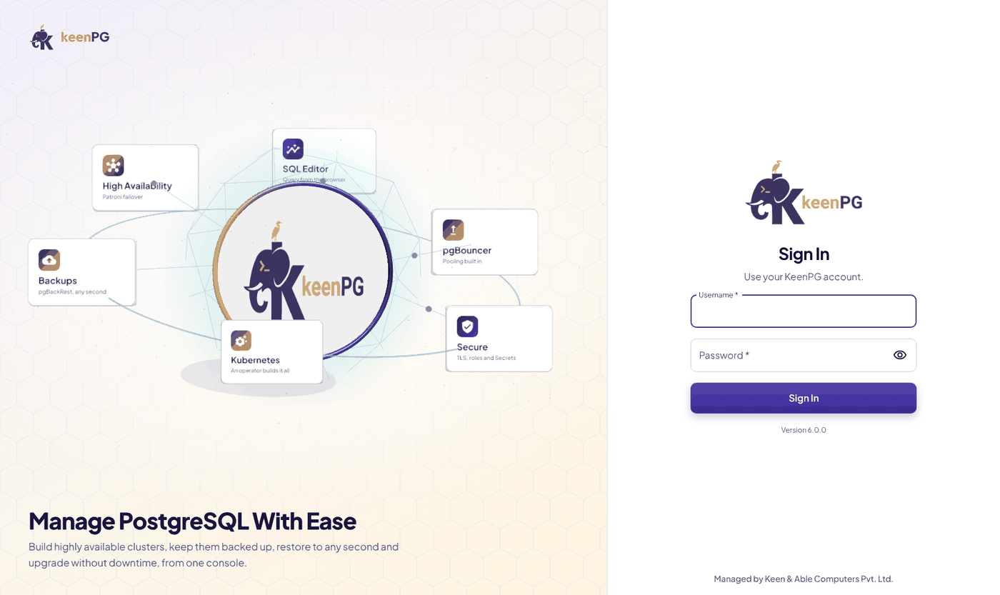
  <br>
  <em>Sign-in page</em>
</p>

1. Open the console address in your browser.
2. Type your **username** and **password**, then click **Sign In**.

**The first password.** Helm makes a random password for the user `admin` and keeps it in the Secret `keenpgo-console-admin`. Read it with:

```sh
kubectl -n keenpg-operator get secret keenpgo-console-admin -o jsonpath='{.data.username}' | base64 -d; echo
kubectl -n keenpg-operator get secret keenpgo-console-admin -o jsonpath='{.data.password}' | base64 -d; echo
```

```text
admin
x7Rk2pQw9LmZ4vTnB8sD   (yours is different)
```

To choose the password yourself, add `--set console.admin.password='Choose-A-Password-1'` to `helm install`.

> [!NOTE]
> **The Secret is only read once**, when the console starts for the first time and there is no admin yet. After that, the password lives in the console's own database. If you change it in the console, the Secret no longer shows it.

> [!WARNING]
> **Change the admin password on day one.** Click your name (top right) → **Change password**.

You stay signed in for 12 hours. To sign out, click your name → **Sign out**.

<details>
<summary><strong>Forgot the admin password?</strong></summary>

<br>

Remove the admin user from the console database and restart the console. It then creates `admin` again with the password from the Secret above. Other users, the audit log and settings are kept.

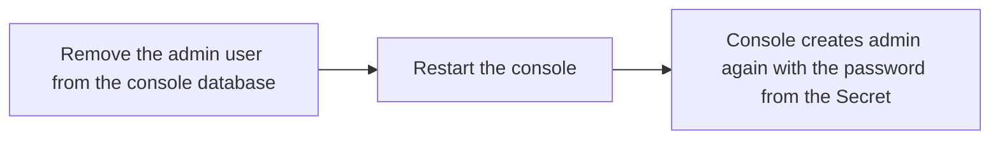

```sh
kubectl -n keenpg-operator exec keenpgo-console-db-0 -- sh -c "PGPASSWORD=\"\$POSTGRES_PASSWORD\" \$(ls -d /usr/pgsql-*/bin | tail -1)/psql -h /tmp -U keenpgo -d keenpgo -c \"DELETE FROM console_users WHERE username = 'admin';\""
kubectl -n keenpg-operator rollout restart deploy/keenpgo-console
```

`DELETE 1` means it worked.

</details>

**Other users** forgot their password? An admin resets it in **Settings → Users** (key icon).

---

## HTTPS and the certificate

The console always uses **HTTPS**. It makes its own **self-signed certificate** the first time it starts, and keeps it in the Secret `keenpgo-console-tls`.

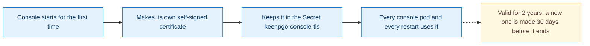

- Nothing else is needed: no cert-manager and no extra job. It works the same with Helm, kubectl, Argo CD and OpenShift.
- Every console pod and every restart uses the same certificate. It is valid for 2 years; the console makes a new one 30 days before it ends.
- `http://` on the same port is sent on to `https://` by itself.

**Stop the browser warning.** Save the certificate and trust it on your computer (it is its own authority):

```sh
kubectl -n keenpg-operator get secret keenpgo-console-tls -o jsonpath='{.data.tls\.crt}' | base64 -d > keenpg-console.crt
```

| System | Steps |
| :---- | :---- |
| 🪟 **Windows** | double-click the file → **Install Certificate** → *Local Machine* → *Trusted Root Certification Authorities*. |
| 🍎 **macOS** | open it in **Keychain Access** → *System* → set *Always Trust*. |
| 🐧 **Linux (Chrome / Firefox)** | browser settings → *Certificates* → *Authorities* → **Import**. |

<details>
<summary><strong>Your address in the certificate.</strong></summary>

<br>

By default the certificate is for the console's service names and `localhost`. To add the IP or name people type in the browser, set `KEENPGO_TLS_HOSTS` and let the console make a new certificate:

```sh
kubectl -n keenpg-operator set env deploy/keenpgo-console KEENPGO_TLS_HOSTS=192.168.49.2,console.example.com
kubectl -n keenpg-operator delete secret keenpgo-console-tls
kubectl -n keenpg-operator rollout restart deploy/keenpgo-console
```

</details>

<details>
<summary><strong>Your own certificate</strong> (from your company's authority or cert-manager)</summary>

<br>

Put it in the same Secret. The console uses it as it is, never replaces it, and picks up a renewed one within 5 minutes:

```sh
kubectl -n keenpg-operator create secret tls keenpgo-console-tls --cert=console.crt --key=console.key \
  --dry-run=client -o yaml | kubectl apply -f -
kubectl -n keenpg-operator rollout restart deploy/keenpgo-console
```

</details>

<details>
<summary><strong>OpenShift</strong></summary>

<br>

Create a passthrough Route, so the browser talks HTTPS straight to the console:

```sh
oc -n keenpg-operator create route passthrough keenpgo-console --service=keenpgo-console --port=https
oc -n keenpg-operator get route keenpgo-console
```

</details>

<details>
<summary><strong>An Ingress or load balancer that already does HTTPS</strong></summary>

<br>

It can send plain HTTP to the console with the header `X-Forwarded-Proto: https`; the console accepts that. Or turn the console's own HTTPS off with `KEENPGO_TLS=off`.

</details>

---

## The screen layout

Every page has the same frame:

| Area | What it does |
| :---- | :---- |
| 🧭 **Left menu** | Opens each page. On small screens it shows only icons; click **»** at the bottom to open it. Pages with an arrow (**Observability**) open a list of sub-pages. |
| 📁 **Project** (top left) | Chooses the project you are working in. **All projects** (the default) shows the clusters of every project you can see. |
| ➕ **Create cluster** (top right) | Starts a new database from any page. |
| 👤 **Your name** (top right) | Change your password, manage users (admins only), sign out. |

<p align="center">
  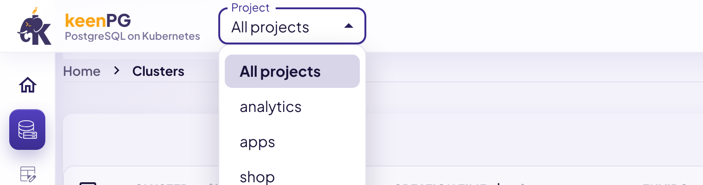
  <br>
  <em>Project list with All projects</em>
</p>

Like **All namespaces** in OpenShift, **All projects** is first in the list. Pick a project to see only its clusters. The lists of clusters, the SQL editor and Backup & Restore follow the project you pick.

> [!NOTE]
> You see only the pages and buttons your role allows. See [Users and access](#users-and-access).

---

## Home

The Home page is your daily check: in one look you see whether everything is fine.

<p align="center">
  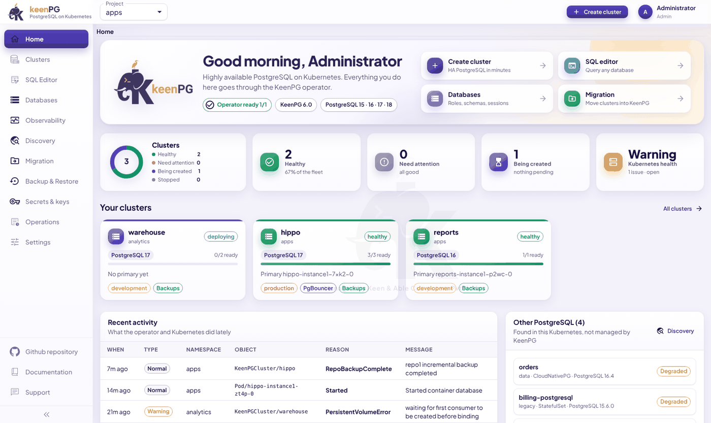
  <br>
  <em>Home page</em>
</p>

**Top card**

- **Operator ready 1/1** means the KeenPG operator is running.
- The chips show the **PostgreSQL versions** you can use.
- The four shortcuts open **Create cluster**, **SQL editor**, **Databases** and **Migration**.

**Count cards**

| Card | Meaning |
| :---- | :---- |
| 🔵 **Clusters** ring | All clusters, split by state. |
| 🟢 **Healthy** | Clusters with every pod ready. |
| 🟠 **Need attention** | Clusters with a problem. Open them first. |
| 🟡 **Being created** | New clusters that are still starting. |
| ☸️ **Kubernetes health** | Problems in Kubernetes itself, for example a node that is not ready. |

**Your clusters**

One card per cluster. Each card shows:

- the PostgreSQL version;
- how many pods are ready (for example `3/3 ready`);
- the current primary;
- labels such as **production**, **PgBouncer** or **Backups**.

Click a card to open the cluster.

Lower on the page, **Recent activity** lists what happened lately (for example "backup completed"). **Other PostgreSQL** lists databases in your Kubernetes that KeenPG does not manage yet.

---

## Create a cluster

Click **Create cluster** (top right). The form has 9 numbered steps. While you fill it, the **Summary** on the right shows what you will get.

```mermaid
flowchart LR
    S1["1. Project and name"] --> S2["2. PostgreSQL"] --> S3["3. Instances and resources"] --> S4["4. Backups"]
    S4 -.-> S5["5. Connection pooling"] -.-> S6["6. Network, security, monitoring"] -.-> S7["7. Users and databases"] -.-> S8["8. PostgreSQL parameters"] -.-> S9["9. Initial data"]
    S9 --> F["Check Summary → Create cluster"]

    classDef must fill:#e3f2fd,stroke:#1976d2,color:#0d3c6e
    classDef opt fill:#f3e5f5,stroke:#7b1fa2,color:#4a148c
    classDef fin fill:#e8f5e9,stroke:#2e7d32,color:#1b5e20
    class S1,S2,S3,S4 must
    class S5,S6,S7,S8,S9 opt
    class F fin
```

<p align="center">
  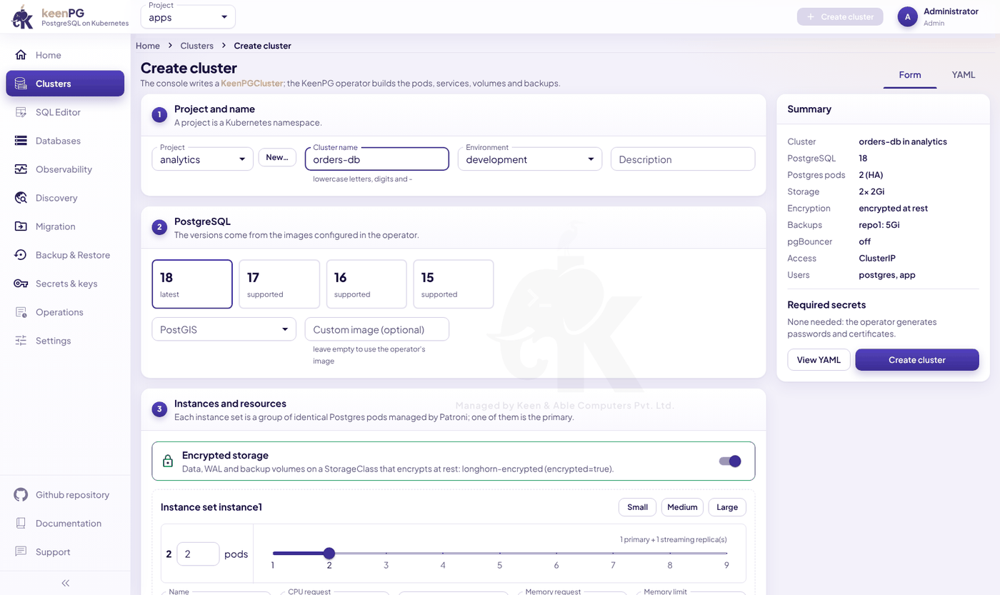
  <br>
  <em>Create cluster: project, name and version</em>
</p>

### Step 1: Project and name

- **Project:** where the cluster will live. Click **New…** to make a new project.
- **Cluster name:** lowercase letters, digits and `-`, for example `orders-db`. You can't change it later.
- **Environment:** development, staging or production. This is a label that helps you sort and find clusters.
- **Description:** optional, for example "orders and payments".

### Step 2: PostgreSQL

- Pick the **version** (15, 16, 17 or 18). Use the newest unless your application needs an older one.
- **PostGIS:** pick a version only if you store maps or locations.
- **Custom image:** leave it empty. KeenPG then uses its own tested image.

<p align="center">
  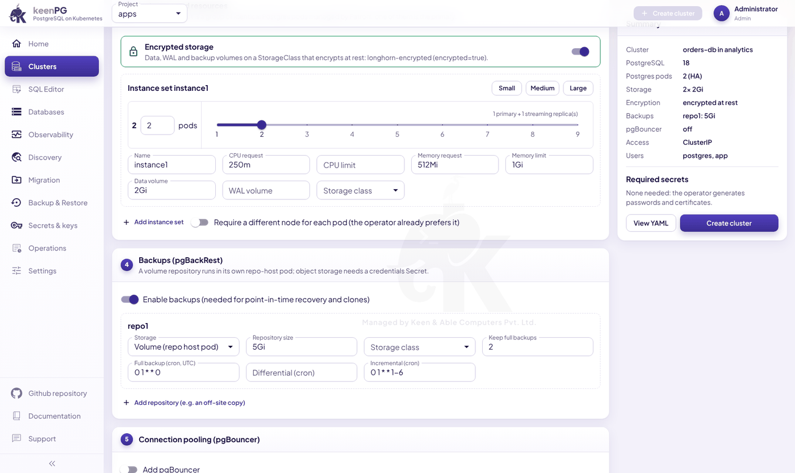
  <br>
  <em>Create cluster: pods, size and backups</em>
</p>

### Step 3: Instances and resources

- **Encrypted storage** turns on by itself when your Kubernetes has encrypting disks.
- **Pods:** how many PostgreSQL servers you get.
  - `1` = a single server, with **no automatic failover**. Fine for testing.
  - `2` or more = one primary plus replicas, with **automatic failover**. **Use this for production.**
- **Size:** click a preset (table below), or type your own values.
- **Require a different node for each pod** puts each copy on a different machine, so one broken machine can't take down every copy.

| Preset | CPU | Memory | Disk |
| :---- | :---- | :---- | :---- |
| Small | 0.25 | 512 MiB | 2 GiB |
| Medium | 1 | 2 GiB | 20 GiB |
| Large | 4 | 8 GiB | 100 GiB |

### Step 4: Backups

- Keep **Enable backups** on. Without backups you can't restore or clone.

- **Storage:** a *volume* (a disk inside Kubernetes) or *object storage* (S3, GCS, Azure). Object storage needs a credentials Secret first, from **Secrets & keys**.

- **Schedules** use cron format, in UTC:

  - **Full:** a complete copy;
  - **Differential:** changes since the last full backup;
  - **Incremental:** changes since the last backup of any type.

  For example, `0 1 * * 0` means every Sunday at 01:00.

- **Keep full backups:** how many full backups to keep. Older ones are removed automatically.

### Steps 5 to 9 (optional)

| Step | What to set |
| :---- | :---- |
| **5. Connection pooling** | Turn on **pgBouncer** if your application opens many connections. |
| **6. Network, security, monitoring** | **ClusterIP** = reachable only inside Kubernetes. **NodePort / LoadBalancer** = reachable from outside. **Monitoring** and **Logging** (below). Extra image pull secrets, your own TLS certificate. |
| **7. Users and databases** | Each user gets a database and a generated password. Keep **Also create the postgres superuser Secret** on to use the SQL editor with full rights. |
| **8. PostgreSQL parameters** | Settings such as `max_connections`. Leave the defaults if you aren't sure. |
| **9. Initial data** | Start empty, or start from another cluster's backup, optionally at a point in time. |

### Monitoring and logging (step 6)

<p align="center">
  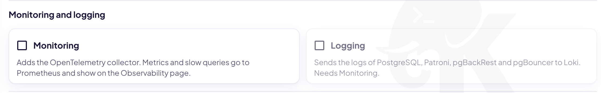
  <br>
  <em>Create cluster: Monitoring and Logging</em>
</p>

Both are **off** unless you tick them:

- **Monitoring** adds the collector to each pod. Metrics and slow queries go to Prometheus and show on the Grafana dashboards. It works for every PostgreSQL version. It is greyed out until monitoring is installed (`kubectl apply -k config/monitoring`).
- **Logging** also sends the logs of PostgreSQL, Patroni, pgBackRest and pgBouncer to Loki. It needs **Monitoring**. It is greyed out until Loki is installed (`kubectl apply -k config/logging`).

You can change both later. See [Monitoring and logging](#monitoring-and-logging).

### Finish

Check the **Summary**, optionally click **View YAML** to see the exact definition, then click **Create cluster**.

The new cluster, and a new project, show up straight away; there is no need to reload the page. It shows **deploying** and is usually ready in 2 to 5 minutes. The first time can take longer, because the images are downloaded.

> [!TIP]
> **No passwords to prepare.** The Summary shows **Required secrets: None needed**. The operator creates every password and certificate by itself.

---

## Clusters list

Click **Clusters** in the menu to see every cluster of the project you picked, or of all projects.

<p align="center">
  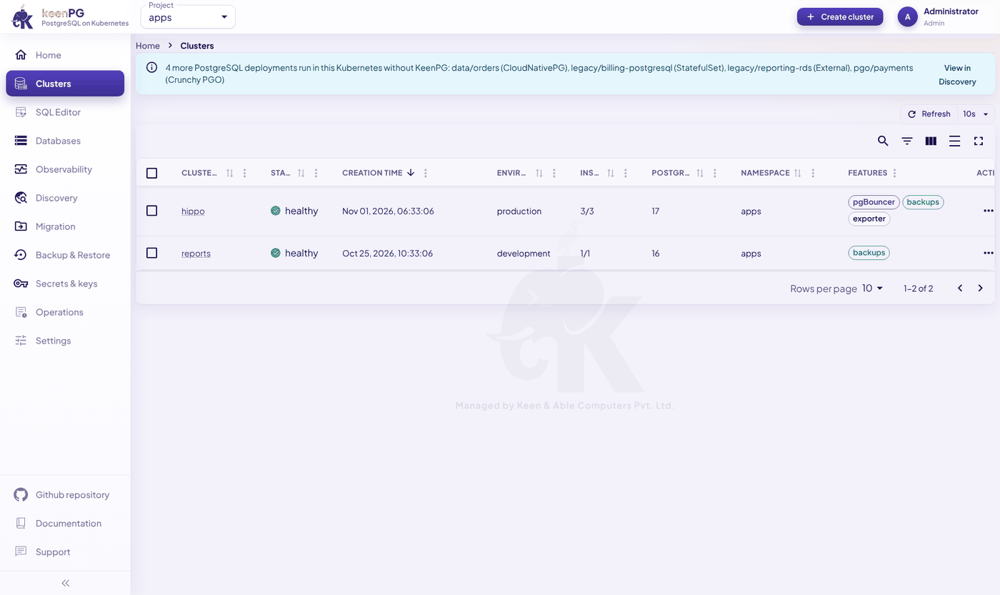
  <br>
  <em>Clusters list</em>
</p>

| Column | Meaning |
| :---- | :---- |
| **Cluster** | The name. Click it to open the cluster. |
| **Status** | `healthy`, `deploying`, `degraded` or `stopped`. |
| **Environment** | The label you chose (development, production…). |
| **Instances** | Ready pods / total pods, for example `3/3`. |
| **PostgreSQL** | Major version. |
| **Namespace** | The project of the cluster. Useful with **All projects**. |
| **Features** | Backups, PgBouncer, **monitoring**, **logging** and so on. |

The list refreshes every 10 seconds, and every 5 seconds while a cluster is being created. Use the icons above the table to search, filter or choose columns.

---


